# Nand2Tetris Capstone – Make the Computer Draw a Box

This repository contains my Nand2Tetris capstone work. The project shows how the Hack computer is built and used, from HDL hardware components to assembly programs and machine code.

## Student Details

- **Student:** Ankit Kumar Pandey
- **University Roll Number:** 2501350030
- **K Value:** 30
- **Course:** ETCCNT301 – Nand to Tetris I
- **Project:** Make the Computer Draw a Box

## Project Overview

The project is organised into three main parts:

| Part | Description |
|---|---|
| **Part A – Hardware Implementation** | Implementation of logic gates, sequential chips, CPU, Memory and the complete Hack Computer using HDL. |
| **Part B – Hack Assembler** | Development of a Python-based two-pass assembler that converts Hack assembly language into 16-bit machine code. |
| **Part C – Box Drawing Program** | Development of a Hack Assembly program that draws a rectangular box on the screen when a keyboard key is pressed and clears it when the key is released. |

## Part A – Hardware Implementation

In this part, I implemented the basic hardware components of the Hack computer using Hardware Description Language (HDL).

### Components Implemented

- Basic logic gates: And, Or, Not, Xor, Mux and DMux.
- Sequential components: Register, RAM and Program Counter (PC).
- ALU (Arithmetic Logic Unit).
- CPU.
- Memory.
- Complete Computer architecture.

The CPU, Memory and Computer implementations are tested using the supplied `.tst` test scripts and their corresponding `.cmp` comparison files.

### Screenshots

**1. CPU Implementation**

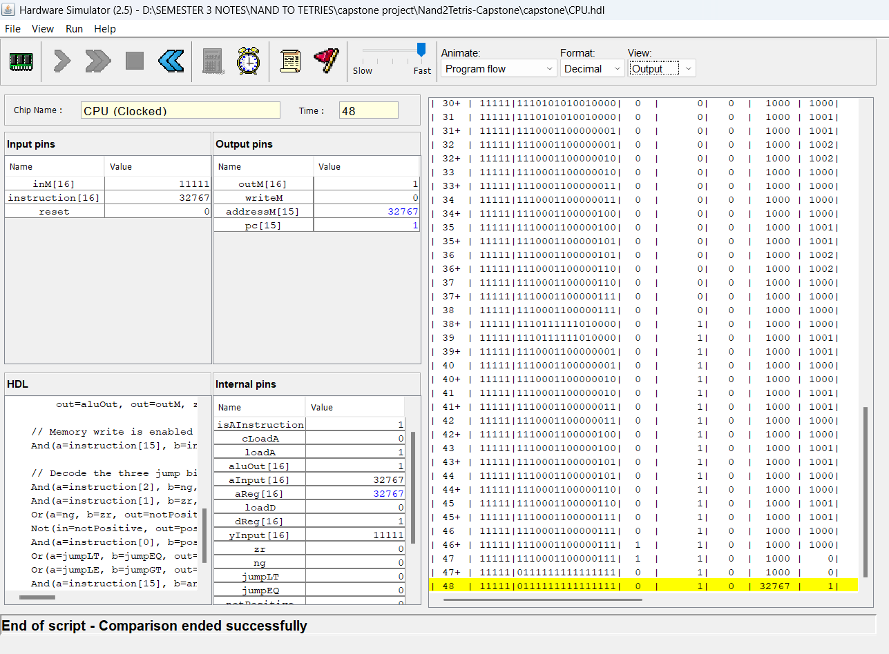

**2. Memory Implementation**

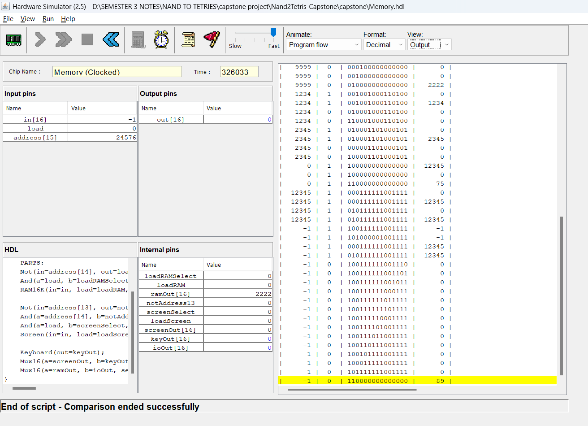

**3. Computer Add Test**

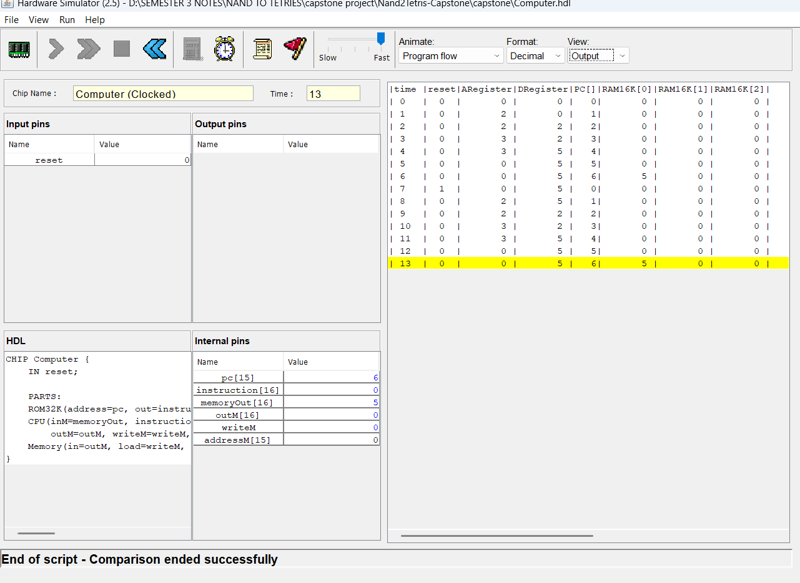

**4. Computer Max Test**

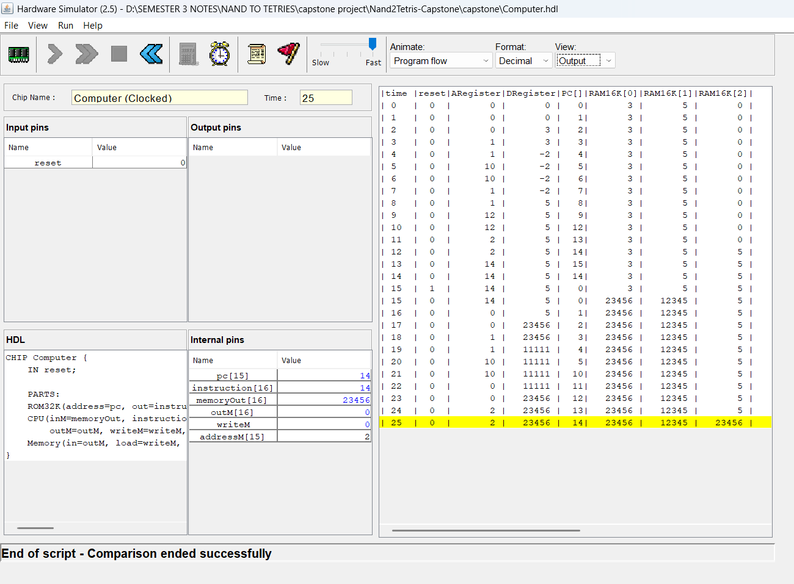

**5. Computer Rect Test**

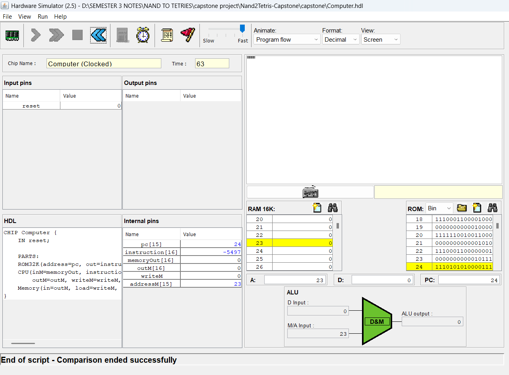

## Part B – Hack Assembler

In this part, I developed a Python-based Hack Assembler.

The main purpose of the assembler is to convert Hack Assembly language instructions into their corresponding 16-bit binary machine code.

### Features

- Reads Hack Assembly (`.asm`) files.
- Supports A-instructions and C-instructions.
- Uses a two-pass assembling approach.
- Creates and manages a symbol table.
- Handles predefined symbols, labels and variables.
- Generates `.hack` machine-code files.
- Reports invalid instructions with their source line numbers.

### Two-Pass Assembler Approach

**Pass 1 – Symbol Table Generation**

The assembler scans the assembly file and identifies labels. It stores their corresponding ROM addresses in the symbol table.

**Pass 2 – Machine Code Generation**

The assembler reads the instructions again and converts them into 16-bit binary machine code. It also resolves variables and symbols using the symbol table.

### Programs Tested

- Add.asm
- Max.asm
- Rect.asm
- Pong.asm

### Screenshots

**1. Assembler Execution**

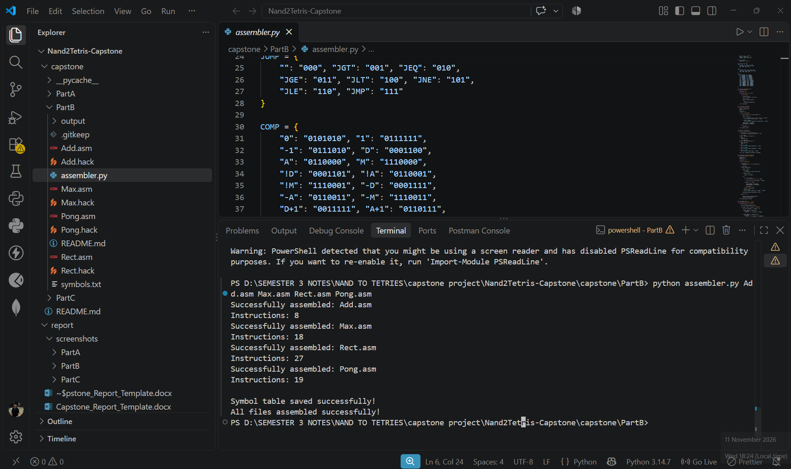

**2. Add Program in CPU Emulator**

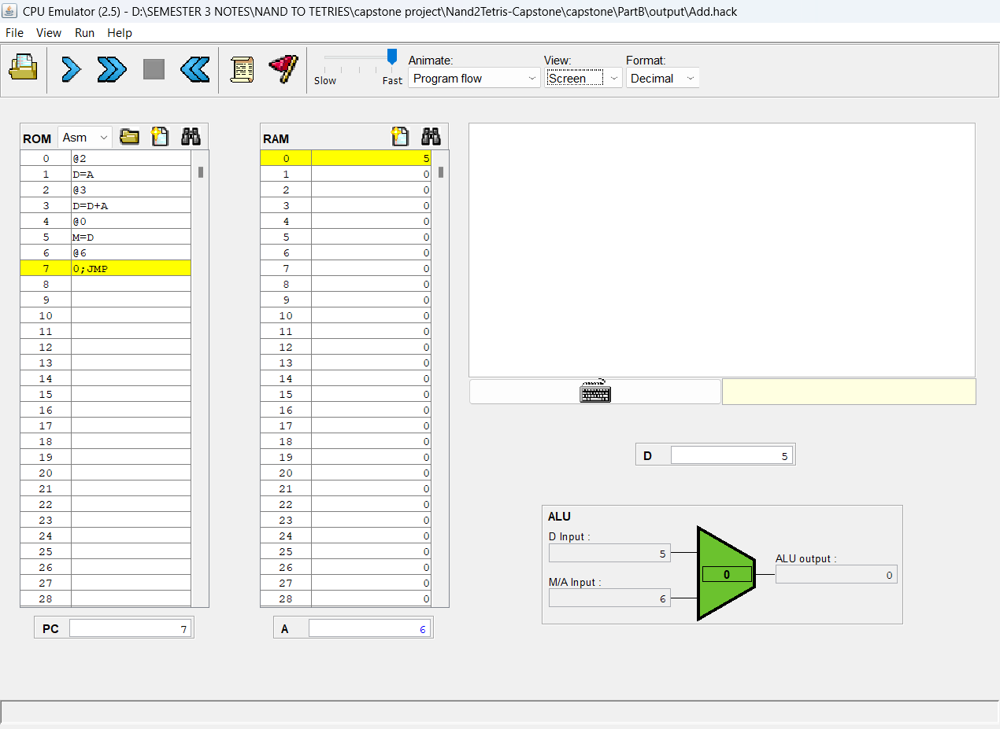

**3. Max Program in CPU Emulator**

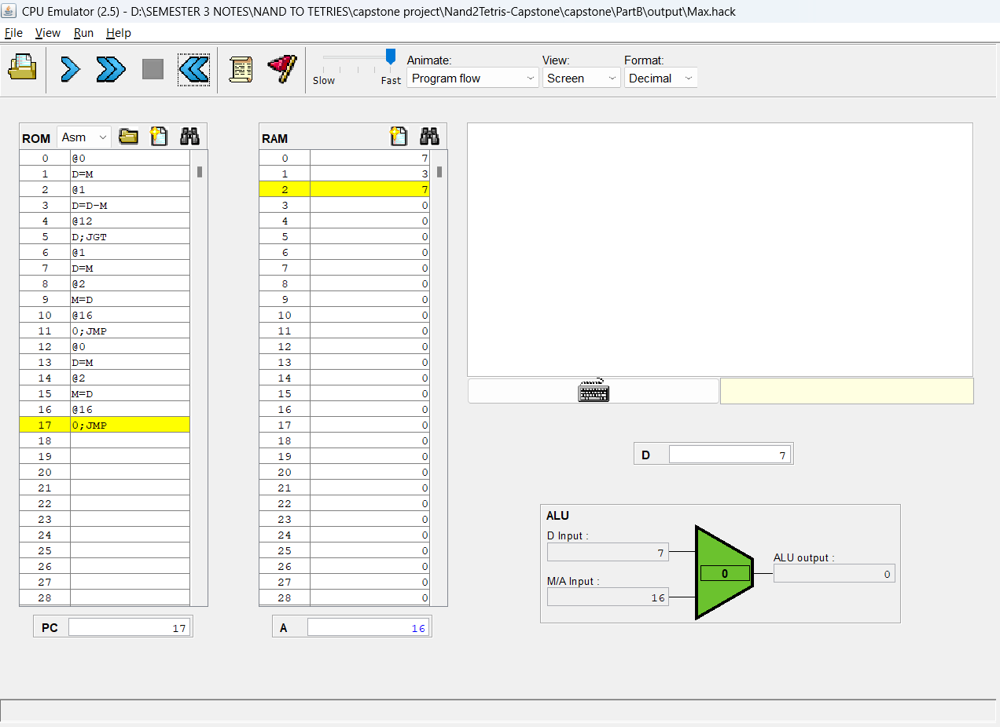

**4. Rect Program in CPU Emulator**

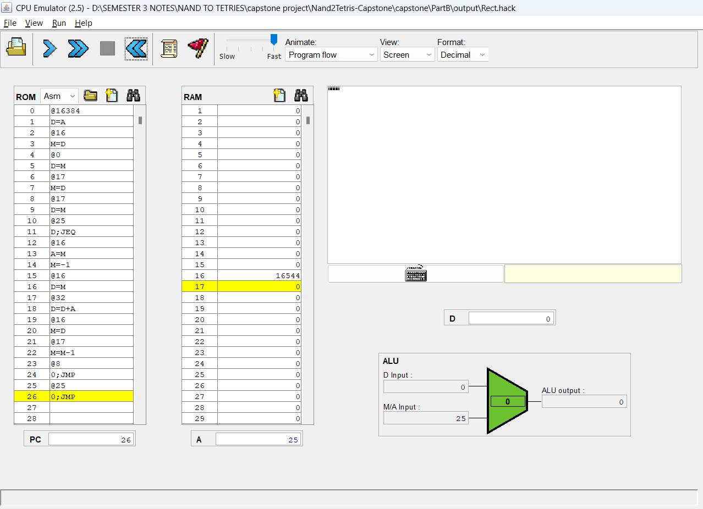


**5. Generated Symbol Table**

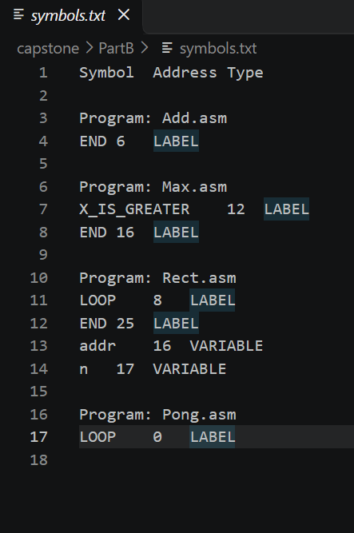

## Part C – Make the Computer Draw a Box

This is the final part of my capstone project.

In this part, I created a Hack Assembly program named `Box.asm` that draws a rectangular box on the Hack computer screen.

The program continuously checks the keyboard input.

- When a key is pressed, the program draws a black rectangular box.
- When the key is released, the program clears the box from the screen.

### Box Dimensions

The dimensions are calculated using my university roll number value, K = 30.

| Parameter | Value |
|---|---|
| K Value | 30 |
| Starting Screen Row | 30 |
| Box Height | 20 rows |
| Box Width | 48 pixels |
| Words Per Row | 3 |

The width is calculated using:

`16 × ((K mod 4) + 1)`

`16 × ((30 mod 4) + 1) = 48 pixels`

Each Hack screen word represents 16 horizontal pixels. Therefore, three screen words are required to draw one row of the box.

The first screen word address is calculated as:

`SCREEN + (32 × 30)`

`16384 + 960 = 17344`

The program writes `-1` to the screen memory locations to draw black pixels and writes `0` to clear them.

### Screenshots

**1. Box Assembly Program**

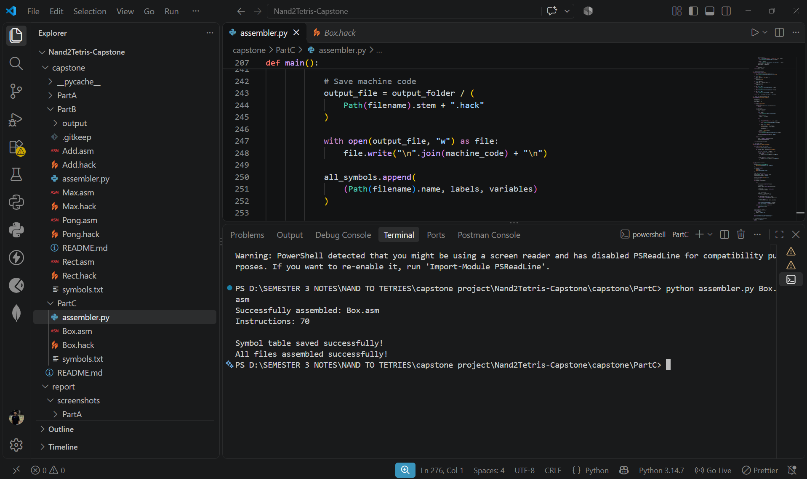

**2. Box Displayed When a Key Is Pressed**

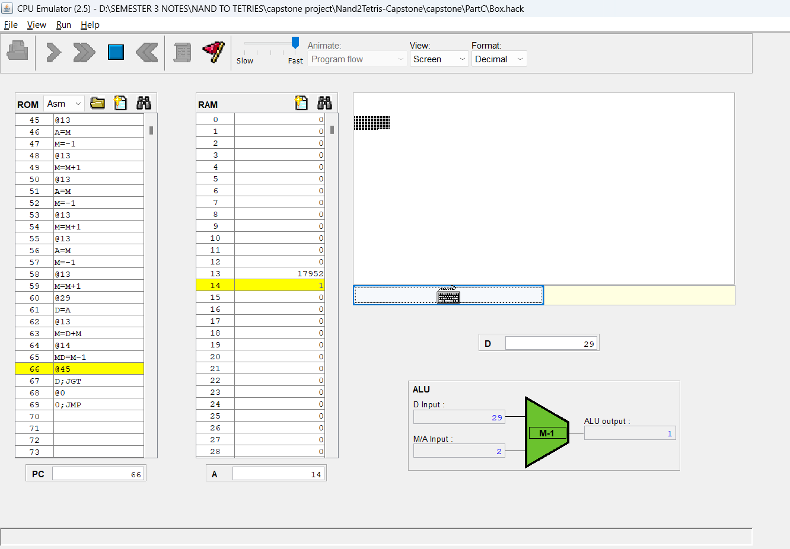

**3. Box Cleared When the Key Is Released**

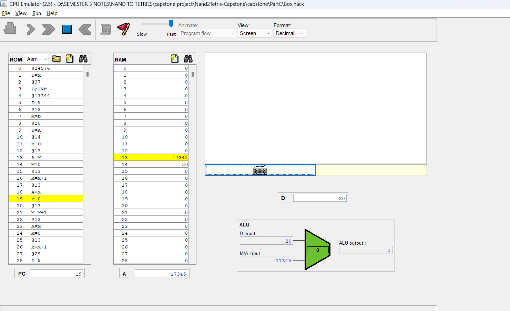

**4. Box Program Symbol Table**

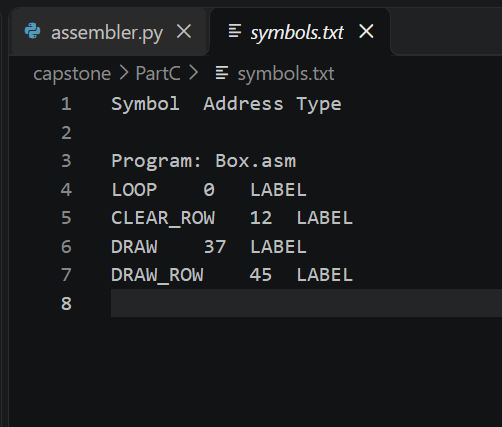

## Project Folder Structure

```text
Nand2Tetris-Capstone/
│
├── README.md
│
├── capstone/
│   ├── README.md
│   ├── assembler.py
│   │
│   ├── PartA/
│   │   ├── PartA1/
│   │   │   ├── And.hdl
│   │   │   ├── Or.hdl
│   │   │   ├── Not.hdl
│   │   │   ├── Xor.hdl
│   │   │   ├── Mux.hdl
│   │   │   ├── DMux.hdl
│   │   │   ├── Register.hdl
│   │   │   ├── Ram.hdl
│   │   │   ├── PC.hdl
│   │   │   └── ALU.hdl
│   │   │
│   │   └── PartA2/
│   │       ├── CPU.hdl
│   │       ├── Memory.hdl
│   │       ├── Computer.hdl
│   │       └── Test files
│   │
│   ├── PartB/
│   │   ├── assembler.py
│   │   ├── Add.asm
│   │   ├── Max.asm
│   │   ├── Rect.asm
│   │   ├── Add.hack
│   │   ├── Max.hack
│   │   ├── Rect.hack
│   │   └── symbols.txt
│   │
│   └── PartC/
│       ├── Box.asm
│       ├── Box.hack
│       ├── assembler.py
│       └── symbols.txt
│
├── tests/
│   └── Python assembler unit tests
│
└── report/
    ├── Capstone_Report_Final.docx
    │
    └── screenshots/
        ├── PartA/
        │   ├── CPU.png
        │   ├── Memory.png
        │   ├── ComputerAdd_Test.png
        │   ├── ComputerMax_Test.png
        │   └── ComputerRect_Test.png
        │
        ├── PartB/
        │   ├── 01_Assembler_Execution.png
        │   ├── 02_Add_CPU_Emulator.png
        │   ├── 03_Max_CPU_Emulator.png
        │   ├── 04_Rect_CPU_Emulator.png
        │   └── 06_Symbol_Table.png
        │
        └── PartC/
            ├── 01_Box_Assembly.png
            ├── 02_Box_Key_Pressed.png
            ├── 03_Box_Key_Released.png
            └── 04_Box_Symbol_Table.png
```

## Technologies and Tools Used

| Technology | Purpose |
|---|---|
| HDL | Hardware component implementation |
| Python | Development of Hack Assembler |
| Hack Assembly | Writing computer programs |
| Nand2Tetris Hardware Simulator | Testing HDL components |
| Nand2Tetris CPU Emulator | Executing Hack machine code |
| VS Code | Writing and managing project files |
| GitHub | Project documentation and version control |

## Requirements

To run this project, you need:

- Python 3.8 or newer.
- Nand2Tetris Software Suite.
- Hardware Simulator.
- CPU Emulator.
- VS Code or another code editor (optional).

The Python assembler uses the standard Python library, so no additional Python packages are required.

## How to Run the Project

### 1. Run Part A – Hardware Implementation

1. Open the Nand2Tetris Hardware Simulator.
2. Navigate to `capstone/PartA/`.
3. Open the required HDL chip file.
4. Load the corresponding test script if available.
5. Run the test and compare the output with the `.cmp` file.

### 2. Run Part B – Hack Assembler

Open the terminal inside:

`capstone/PartB/`

Run the following command:

```bash
python assembler.py Add.asm Max.asm Rect.asm Pong.asm
```

The assembler generates the following files:

- Add.hack
- Max.hack
- Rect.hack
- Pong.hack
- symbols.txt

Open the generated `.hack` files in the Nand2Tetris CPU Emulator to check their execution.

Note: Pong.asm is a compact screen-write demonstration, not the complete official Pong game.

### 3. Run Part C – Box Drawing Program

Open the terminal inside:

`capstone/PartC/`

Run:

```bash
python assembler.py Box.asm
```

After generating `Box.hack`:

1. Open the Nand2Tetris CPU Emulator.
2. Load the `Box.hack` file.
3. Start program execution.
4. Press a key in the keyboard panel.
5. Observe the rectangular box on the screen.
6. Release the key and observe the box being cleared.

### 4. Run Python Unit Tests

Open the terminal in the main project folder and execute:

```bash
python -m unittest discover -s tests -v
```

The tests check machine-code generation, label and variable addresses, symbol-table output and invalid instruction handling.

## Learning Outcomes

Through this project, I learned:

- How basic logic gates work together to create complex hardware.
- How sequential circuits and memory components are implemented.
- How the CPU, Memory and Computer are connected.
- How Hack Assembly instructions work.
- How an assembler converts assembly instructions into machine code.
- How symbol tables are created and used.
- How computer memory is used to display graphics on the screen.
- How hardware and software work together in a computer system.

## Conclusion

This Nand2Tetris capstone project helped me understand how a computer works from the hardware level to software execution.

I implemented hardware components using HDL, developed a Python-based assembler, and created a Hack Assembly program that draws and clears a rectangular box on the screen.

Overall, this project gave me practical experience with computer architecture, digital logic, assembly language, memory management and machine-code generation.

---

**Project:** Make the Computer Draw a Box  
**Course:** ETCCNT301 – Nand to Tetris I  
**Student:** Ankit Kumar Pandey